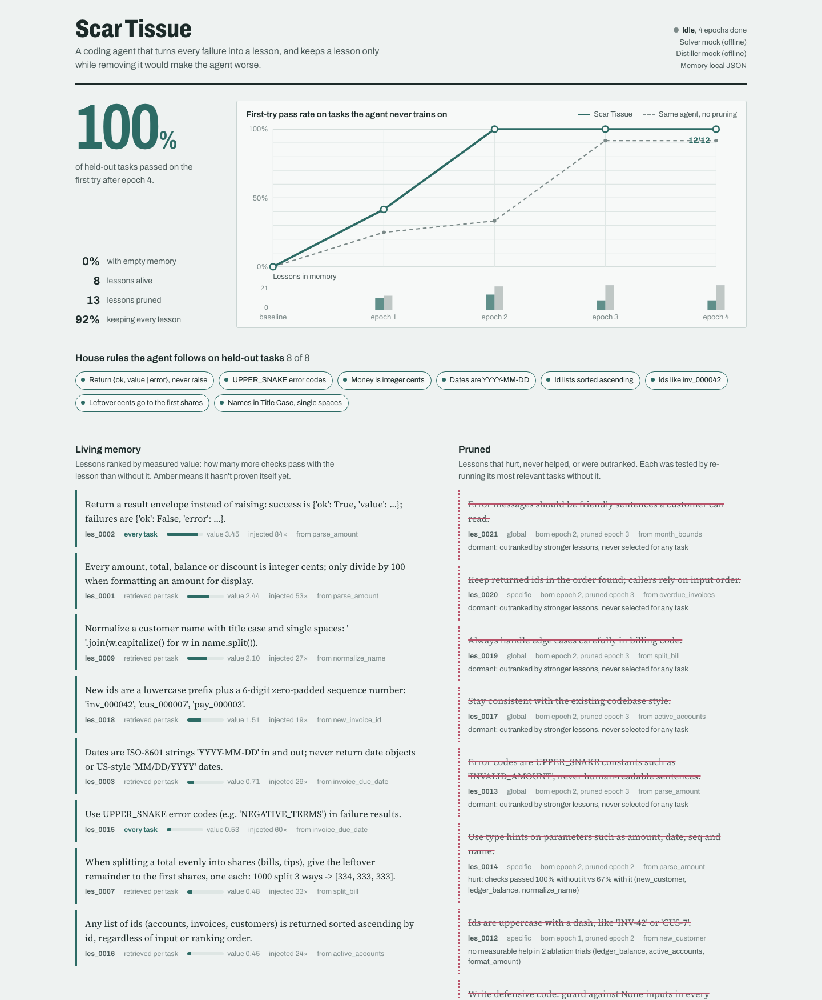
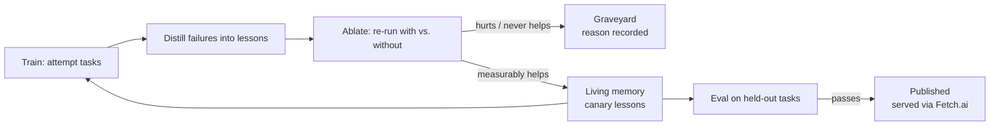
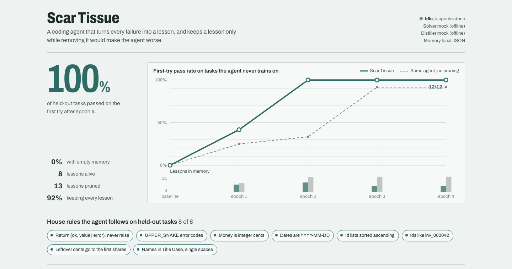

<p align="center">
  
</p>

<h1 align="center">Scar Tissue</h1>

<p align="center">
  <strong>A coding agent that turns every failure into a lesson — and keeps a lesson only while removing it would make the agent worse.</strong>
</p>

<p align="center">
  <a href="#quick-start">Quick start</a> ·
  <a href="#how-it-works">How it works</a> ·
  <a href="#results">Results</a> ·
  <a href="#production-addons">Production addons</a> ·
  <a href="docs/fetch-schema.json">Fetch.ai schema</a>
</p>

<p align="center">
  
  
  
  
</p>

<p align="center">
  Built for the AI Engineer Code Summit hackathon track <em>“systems that get measurably better with every run.”</em><br>
  Built on the <strong>Meta ecosphere</strong> — Meta Wonder · Meta Spark · Muse Glimmer<br>
  Research: <strong>Subquadratic (SubQ)</strong> · Front-end schema: <strong>Fetch.ai</strong> · Benchmark testing: <strong>Google Gemini</strong>
</p>

---

## Why Scar Tissue?

Most agent memory is append-only. Every reflection gets saved, and memory slowly fills with vague advice and confidently wrong rules. The agent doesn't get smarter — it gets noisier.

Scar Tissue treats every lesson as a **hypothesis that must earn its place**:

1. Failures are distilled into candidate lessons.
2. Every epoch, each lesson is **ablated**: its most relevant tasks are re-run with and without it.
3. Lessons that hurt, never help, or are never selected get **deleted** — with the measured reason recorded.

What survives is a small lesson library with evidence behind every rule. In the benchmark below, memory converges from 20+ accumulated lessons to **8 proven ones — one per hidden house rule**.



<p align="center"><em>The live dashboard: learning curve (solid) vs. the same agent keeping every lesson (dashed), living memory ranked by measured value, and the graveyard with prune reasons.</em></p>

---

## How it works

```text
epoch 0   baseline: score held-out tasks with empty memory
epoch n   1. TRAIN    attempt each training task, up to 3 tries with test feedback
          2. DISTILL  turn each failure (+ the eventual fix) into candidate lessons; dedupe into memory
          3. ABLATE   for each lesson: re-run its most relevant tasks with vs. without it
                        hurt (fewer checks pass with it)      -> pruned
                        no measurable help after 2 trials     -> pruned
                        outranked, never selected for a task  -> pruned
          4. EVAL     pass@1 on held-out tasks, no feedback, memory read-only
```



**Scarce slots make pruning matter.** Only 2 global lessons are injected into every task, plus 3 retrieved per task by vector similarity. A useless lesson isn't free — it occupies a slot a useful one needed, and a wrong one actively misleads.

**Failures are classified, not just logged.** `scartissue/classifier.py` tags every failure from its visible messages (`envelope`, `error_code`, `value_mismatch`, `load_error`, `timeout`, plus domain tags). Each lesson stores its `failure_class`, so the library is searchable by the kind of mistake that produced it.

---

## The benchmark: Acme Ledger

A fictional billing codebase with eight **unwritten** house rules. Task prompts never state them — like joining a real team, the only way to learn them is to ship code, fail review, and remember why.

| Rule | Example |
|---|---|
| Never raise; return `{'ok': True, 'value': v}` / `{'ok': False, 'error': CODE}` | |
| Error codes are UPPER_SNAKE | `'INVALID_AMOUNT'` |
| Money is integer cents | `'$12.50'` → `1250` |
| Dates are `YYYY-MM-DD` | |
| Id lists sorted ascending | |
| Ids are prefix + 6 zero-padded digits | `inv_000042` |
| Leftover cents go to the first shares | 1000 split 3 ways → `[334, 333, 333]` |
| Names normalized to Title Case, single spaces | `'  ada   LOVELACE '` → `'Ada Lovelace'` |

12 training tasks and 12 **held-out** eval tasks. Eval tasks are never trained on, so the curve measures transfer across functions sharing the same conventions — not memorized solutions. Each test check carries a hidden tag naming the rule it enforces; the model never sees it. `python scar.py selfcheck` proves every task catches every rule it covers (24/24).

---

## Results

Reproduce with: `python scar.py compare --mock --epochs 4 --seeds 3`

Offline simulation, mean ± std across 3 seeds (12 held-out tasks per epoch):

| Epoch | Scar Tissue pass@1 | Lessons | No pruning pass@1 | Lessons |
|---|---|---|---|---|
| baseline | 0% ± 0% | 0.0 | 0% ± 0% | 0.0 |
| 1 | 36% ± 8% | 11.0 | 31% ± 8% | 12.0 |
| 2 | 100% ± 0% | 11.7 | 58% ± 30% | 18.3 |
| 3 | 100% ± 0% | 8.0 | 81% ± 22% | 19.0 |
| 4 | 97% ± 4% | 8.0 | 92% ± 0% | 19.0 |



From epoch 2 on, Scar Tissue holds 97–100% while memory converges to ~8 lessons. The control arm keeps ~19 lessons and stays volatile (58% ± 30% at epoch 2).

> **Read this honestly.** These numbers come from the offline mock model, whose distiller is *configured* to emit useless advice 45% of the time and a wrong rule 15% of the time (stated in `scartissue/agent.py`, not tuned to widen the gap). The gap comes from wrong and redundant lessons the control arm can never remove. The real test is a real-model run — see [Real models](#real-models) and run `compare --provider gemini --epochs 5 --seeds 3` to validate the curve on a second model family.

---

## Quick start

```bash
git clone https://github.com/coldrazer/Scar-Tissue && cd Scar-Tissue
python scar.py selfcheck                 # verify the benchmark (24/24)
python scar.py serve &                   # dashboard on http://localhost:8787
python scar.py demo --mock --epochs 6    # control arm, then a slow live run to watch
```

No dependencies needed: the loop, sandbox, dashboard, and model clients use only the Python standard library. Optional extras (`pymongo`, `uagents`) unlock MongoDB storage and the Fetch.ai agent.

| Command | What it does |
|---|---|
| `run` | Run learning epochs (`--fresh` to wipe memory, `--no-prune` for the control arm) |
| `compare` | Scar Tissue vs. keep-every-lesson control, from scratch (`--seeds N` for mean ± std) |
| `demo` | Build the control arm quickly, then replay Scar Tissue slowly for a live audience |
| `serve` | Live dashboard + API: learning curve, living memory, graveyard, per-task grid, job endpoints |
| `jobs` / `audit` | List background runs / print the cost ledger and every keep/prune/publish decision |
| `govern` | Lesson governance: `approve\|hold\|release\|retire\|revive <id>` |
| `lessons` / `export` | Print the library + graveyard / write surviving lessons to `LESSONS.md` for `CLAUDE.md`, `AGENTS.md`, or a system prompt |
| `selfcheck` | Prove each benchmark task detects each rule it covers |
| `models` / `ping` | List an endpoint's models / test the configured endpoints |
| `reset` | Wipe memory and history |

---

## Real models

Copy `.env.example` to `.env` and add keys. Every provider is reached through an OpenAI-compatible endpoint. Solver and distiller providers are independent and can be mixed (including mock + real).

```bash
python scar.py ping --provider meta                        # check the key and model
python scar.py run --provider meta --epochs 5 --fresh      # Llama solves and distills
python scar.py run --provider meta --distill-provider gemini --fresh   # Llama solves, Gemini distills
python scar.py compare --provider gemini --epochs 5 --seeds 3          # benchmark testing on Gemini
python scar.py compare --provider subq --epochs 5 --seeds 3            # research run on SubQ
```

| Partner | Role in Scar Tissue |
|---|---|
| **Meta Llama API** | Default solver and distiller (`--provider meta`, `api.llama.com/compat/v1`) |
| **Google Gemini** | Benchmark testing: independent solver/distiller pair (`--provider gemini`) |
| **Subquadratic SubQ** | Research backend (`--provider subq`; `SUBQ_BASE_URL` / `SUBQ_API_KEY` / `SUBQ_MODEL`) |
| **MongoDB / Atlas** | Persistent lesson memory with vector search (`MONGODB_URI`; Atlas `$vectorSearch` with in-memory cosine fallback) |
| **Fetch.ai** | Front-end lesson schema + agent (`agents/fetch_agent.py`; contract in `docs/fetch-schema.json`) |

Real-model runs use temperature 0, cache identical probes within an epoch, and average each ablation probe over `--probe-repeats` attempts (default 3). A run is roughly 100 model calls per epoch; `--workers` sets parallelism. Prices and a hard budget cap are configured with `SCAR_PRICE_*_PER_MTOK` and `SCAR_MAX_COST_USD`.

---

## Lesson memory & retrieval

Every lesson carries a 256-dim embedding (hashed-token vectors, standard library only — offline runs need no embedding API). Retrieval is vector cosine similarity. On MongoDB Atlas the same vectors are served server-side by `$vectorSearch` (index `lesson_vector`); on plain MongoDB or the JSON store, identical in-memory cosine returns the same rankings, so behavior doesn't depend on the store. Lessons, epochs, and events persist in MongoDB when `MONGODB_URI` is set (events expire after 7 days via TTL index); otherwise everything lives in `runs/state.json`.

## Fetch.ai: the front-end lesson schema

The curated library is published as a Fetch.ai uAgent so other coding agents can query it. The integration contract — `LessonQuery` / `Lesson` / `LessonReply` — is published as JSON Schema in [docs/fetch-schema.json](docs/fetch-schema.json); front ends and agents integrate against the schema without reading agent code.

```bash
pip install uagents
SCAR_AGENT_SEED='<a private random phrase>' python agents/fetch_agent.py   # :8001
curl -s localhost:8001/lessons -H 'content-type: application/json' \
     -d '{"task": "write a function that splits a bill between people", "k": 3}'
```

Only **published** lessons are served (see governance below). The agent seed is the agent identity: there is deliberately no default, and an optional `SCAR_AGENT_TOKEN` gates queries.

## Lesson governance

Lessons are born `canary`: usable by the training loop, invisible to external consumers. A canary is auto-**published** once it appears in a passing held-out evaluation. `held` lessons are never injected anywhere. Operators get manual control, and every transition bumps the lesson version:

```bash
python scar.py govern approve <id>   # canary -> published
python scar.py govern hold <id>      # stop injecting immediately
python scar.py govern release <id>   # held -> canary
python scar.py govern retire <id>    # manual prune, reason recorded
python scar.py govern revive <id>    # resurrect a pruned lesson as canary
```

## Production addons

Five addons take Scar Tissue from demo to operable system. All are stdlib-only (container runs shell out to docker/podman) and covered by tests.

1. **Container isolation** (`SCAR_SANDBOX=container`). One throwaway container per task run: `--network none`, read-only root and code mount, tmpfs `/tmp`, 512 MB / 1 CPU / 64 pids, `--cap-drop ALL`, `no-new-privileges`. `auto` prefers a container when a daemon answers; unset keeps the hardened subprocess (rlimits + audit hook denying network and writes outside temp) for fast local runs.
2. **Auth + tenancy** (`SCAR_API_KEYS="acme:key,..."`). Every `/api/*` call needs a key (`Authorization: Bearer` or `X-API-Key`, verified in constant time); each key maps to one tenant with an isolated lesson store. No keys = open local mode, with a warning when bound beyond localhost.
3. **Background job runner**. `POST /api/jobs {epochs, seed, prune, idempotency_key}` starts a run on a worker thread; poll `GET /api/jobs/<id>`. Idempotency keys dedupe resubmits. Jobs persist in `runs/jobs.json`; after a restart, unfinished jobs read `interrupted` and resubmission resumes from stored epochs.
4. **Cost ledger + budget cap**. Every epoch records calls, tokens, and USD cost. The cap stops the run — checked after the baseline, so a capped run never burns epochs it can't pay for. `python scar.py audit` prints the ledger plus every decision with its deltas.
5. **Lesson governance** (above). Canary → published lifecycle with manual override and one-canary opt-in for external consumers.

## Architecture

```text
scar.py                   CLI (run, compare, demo, serve, jobs, audit, govern, ...)
scartissue/benchmark.py   Acme Ledger tasks, tests, and the hidden rules (12 train + 12 held-out)
scartissue/harness.py     test harness (checks, hidden rule tags)
scartissue/sandbox.py     subprocess (rlimits + audit hook) or container-per-run isolation
scartissue/agent.py       LLM agent (solve, distill) and the offline mock agent; providers mix freely
scartissue/classifier.py  failure classifier: tags lessons from visible failure messages only
scartissue/memory.py      lessons with embeddings, vector retrieval, dedupe, JSON and MongoDB stores
scartissue/loop.py        train, distill, ablate, eval; cost ledger, budget cap, canary promotion
scartissue/auth.py        API keys mapped to tenants, constant-time verification
scartissue/jobs.py        persistent background job runner (idempotent, resumable)
scartissue/server.py      dashboard + API server (auth, tenancy, jobs)
scartissue/static/        the dashboard (index.html)
agents/fetch_agent.py     Fetch.ai uAgent serving published lessons
docs/fetch-schema.json    published LessonQuery/LessonReply front-end schema
docs/assets/              banner and dashboard screenshots
tests/test_scar.py        24 tests: benchmark, sandbox escapes, auth/tenancy, jobs, budget, governance, real-LLM path vs. a fake OpenAI-compatible server
```

Run the tests with `python -m unittest discover -s tests -v`.

## Notes and limits

- The sandbox is defence in depth, not a boundary for genuinely untrusted code. Use `SCAR_SANDBOX=container` in production; use a container with no host mounts for hostile workloads.
- Ablation is still an estimator with real models. Repeated probes, the −0.02 hurt margin, score decay, and the 2-trial rule make it robust, but a good lesson can occasionally be pruned and rediscovered later.
- Held-out means held-out *tasks*: eval functions are never trained on, but they share the 8 house conventions. The curve measures transfer across functions, not discovery of brand-new rules.
- Mock results are a simulation with stated noise rates. Treat real-model `compare` runs (multiple seeds) as the evidence.

## Built on

Scar Tissue was built on the **Meta ecosphere**:

- **Meta Wonder** — the building environment where the agent loop, benchmark and dashboard were developed.
- **Meta Spark** — rapid prototyping and iteration during the hackathon build.
- **Muse Glimmer** — the coding assistant used to write, audit and fix the codebase.

Also built with:

- **Subquadratic (SubQ)** — *research backend* for long-context lesson experiments, compared seed-for-seed against the other providers.
- **Fetch.ai** — *front-end schema*: the published `LessonQuery`/`LessonReply` contract in [docs/fetch-schema.json](docs/fetch-schema.json), served by the uAgent.
- **Google Gemini** — *benchmark testing*: an independent solver/distiller family validating the learning curve.

## License

Apache 2.0 — see [LICENSE](LICENSE).
